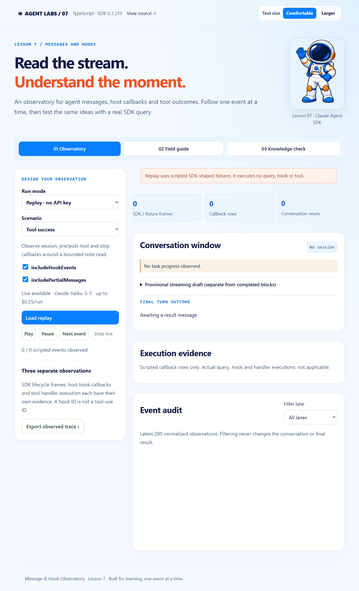

# Lesson 7 Message & Hook Observatory

A runnable companion to **Claude Agent SDK TypeScript version 0.3.310**, Lesson 7: **Messages and Hooks**. Observe a typed message stream, step through explicit teaching fixtures, and compare hook callbacks with actual tool execution.



## Visual style and reading controls

The interface follows the course reference apps: pale blue backgrounds, navy text, orange heading accents, blue controls, rounded panels, and the course astronaut mascot. The screenshot above shows the refreshed design.

| Reading element            | Default presentation                                             |
| -------------------------- | ---------------------------------------------------------------- |
| Body text                  | **21 px**, with comfortable line spacing                         |
| Labels and supporting text | Approximately **18–20 px** or larger                             |
| Code                       | Approximately **20 px**, wrapping within its panel               |
| Larger setting             | **24 px** base text, with scalable labels, controls and headings |

Use **Text size → Larger** in the page header when you need bigger text. Choose **Comfortable** to return to the default size. The choice is saved in this application's browser storage and remains after a reload; it makes no API request. Browser zoom is also available.

On phones and narrower windows, navigation and work areas stack so controls and text remain usable. You can open **Lesson focus & author** where that panel is available. Lesson activities, practice/live distinctions, permissions and server-side key handling continue to work as described below.

The shared presentation files are `src/client/course-theme.css` (palette and layout), `src/client/course-theme.ts` (reading preference and course presentation), and `public/course-astronaut.png` (reference mascot). See [visual style details](docs/visual-style.md) for the reference sources and a full-size screenshot.

### Update an existing checkout

Pull the latest changes and restart the local app:

```sh
git pull --ff-only
npm ci
npm run dev
```

Refresh the browser tab to load the updated interface. The lesson-specific local URL and first-run instructions are listed below.

## Start here

Use Node.js **22.14+** (or 24) and npm.

```sh
git clone https://github.com/luiscoco/claude-agent-sdk-lesson-07.git
cd claude-agent-sdk-lesson-07
npm ci
npm run dev
```

Open **http://127.0.0.1:4371**. Choose a scenario, click **Load replay**, and use **Next event** or **Play**. Replay works without an account or API key and makes no model calls.

## What students will learn

- Narrow messages by `type` and, for system messages, `subtype` before reading family-specific fields.
- Keep completed conversation blocks, provisional streaming deltas, task progress, and final results in separate views.
- Apply top-level `conversation_reset` messages to conversation UI state while preserving the audit; compaction is a different event.
- Configure real `SessionStart`, `PreToolUse`, `PostToolUse`, `PostToolUseFailure`, `PermissionRequest`, `Notification`, and `Stop` callbacks using SDK matcher objects.
- Distinguish a host callback, an SDK hook lifecycle frame, and a tool handler. Their counts need not match.
- Separate logging, additional context, explicit hook denials, and `canUseTool` permission decisions.

## Five scenarios

| Scenario          | Replay        | Live                           | Key idea                                                      |
| ----------------- | ------------- | ------------------------------ | ------------------------------------------------------------- |
| Tool success      | Scripted      | Actual note read               | Pre/post callbacks and bounded enrichment                     |
| Tool failure      | Scripted      | Controlled MCP error           | Tool failure can still produce a successful final explanation |
| Hook-blocked call | Scripted      | Explicit `PreToolUse` denial   | Deny before the tool handler                                  |
| Permission denied | Scripted      | Logged request and host denial | Returning `{}` from logging grants nothing                    |
| Progress & reset  | Scripted only | Unavailable                    | Reset UI, retain audit, ignore stale conversation updates     |

**Replay is synthetic teaching data**, including its callback rows, lifecycle frames, identifiers, costs and outcomes. No hook or tool runs during replay. It illustrates possible message families and ordering, not a recording or a guaranteed SDK event sequence. `includeHookEvents:false` filters fixture lifecycle frames except SessionStart/Setup; callbacks remain visible as scripted rows. `includePartialMessages:false` removes fixture partial messages.

Live mode uses the installed SDK and actual host callbacks. The browser receives selected, normalized fields; it does not receive your API key, raw tool arguments, raw tool result bodies, or hidden reasoning. The trace exporter contains the submitted configuration and retained observations, not later control edits. The audit retains the latest 200 events, conversation the latest 40 blocks, and draft the latest 12,000 characters. This is a learning presenter, not a complete SDK schema validator or durable log collector.

## Enable live scenarios

Copy `.env.example` to `.env`, then supply **your own Anthropic API key** and an API-accessible model. Never commit `.env`. The key remains on the local Node.js server.

```dotenv
ANTHROPIC_API_KEY=your-key-here
ANTHROPIC_MODEL=your-available-model-id
PORT=4371
```

Restart the server after editing `.env`. Choose **Live · real SDK query**, then **Run live scenario**. These calls consume API credits. Each query has a $0.25 budget, six-turn cap and 90-second abort timer. These are SDK limits, not a billing quote; the app runs one query at a time. The host permits only its fixed read-only note tool; there are no built-in shell or file-edit tools, arbitrary prompts, or user-selected filesystem paths. The protected preview has a fail-closed handler and the separate host policy denies every permission request reaching it. **Stop live** or disconnecting cancels the query; host cleanup closes resources separately from the `Stop` callback.

```sh
npm run live:smoke          # one real success scenario
npm run live:smoke -- --all # five billable runs, including hook-frame flag off
```

### Important observed runtime behavior

The five real verification runs on 2026-11-02 invoked pre/post/failure/permission/stop callbacks as appropriate. They produced **zero SDK hook lifecycle frames**, including runs with `includeHookEvents:true`; configured `SessionStart` and `Notification` callbacks were also not invoked in those runs. The app reports those zeros honestly and does not manufacture live observations. Configuring a callback or requesting lifecycle frames is not proof they occurred. See [live verification](docs/live-verification.md) for counts and limits of this evidence.

The SDK may emit `CLAUDE_SDK_CAN_USE_TOOL_SHADOWED`: the note tool is intentionally pre-approved through `allowedTools`, so it bypasses `canUseTool`. The protected tool requests permission; the host denies it. The blocked scenario demonstrates that a pre-approved tool can still be denied by its `PreToolUse` hook.

## Code tour

| File                     | Responsibility                                                      |
| ------------------------ | ------------------------------------------------------------------- |
| `src/shared/observe.ts`  | Guarded selected-field message projection and conversation reducer  |
| `src/server/hooks.ts`    | Focused callbacks, matcher objects, explicit deny, enrichment       |
| `src/server/runner.ts`   | Real SDK query options, permissions, counters, abort and cleanup    |
| `src/server/tools.ts`    | Fixed MCP note read, controlled failure, protected fail-closed stub |
| `src/server/fixtures.ts` | Explicit synthetic teaching frames; never invokes query or hooks    |
| `src/server/app.ts`      | Local HTTP/SSE API and single-live-run admission                    |
| `src/client/main.ts`     | Observatory, trace export, source guide and quiz                    |

The conceptual slide snippet with a bare callback array must be adapted to the actual 0.3.310 API:

```ts
hooks: {
  PostToolUse: [{
    matcher: '^mcp__lesson__(observe_note|protected_preview)$',
    hooks: [async (input, toolUseID, { signal }) => {
      // Observe only the fields your app needs.
      return {}; // No permission decision.
    }],
  }],
}
```

The implementation adds bounded `additionalContext` for successful tool outcomes. `PreToolUse` denies only the blocked scenario. `PermissionRequest` logging returns `{}` and `canUseTool` independently returns `behavior:'deny'`. Hook lifecycle frames use `hook_id`; callback/tool correlation uses tool-use IDs where supplied. The app never equates those IDs or guesses correlation from timestamps.

## Exercises and validation

Follow [the classroom walkthrough](docs/walkthrough.md), then use the built-in knowledge check.

```sh
npm run check       # typecheck, unit/HTTP tests, production build
npm run replay:cli  # reset exercise without a key
npm run api:check   # installed version and public API contract
npx playwright install chromium
npm run test:e2e    # production browser exercises
npm start          # serve the production build on 4371
```

On a workstation with Chrome already installed, PowerShell users can set `$env:PLAYWRIGHT_CHANNEL='chrome'` before `npm run test:e2e`. GitHub Actions tests Node 22 and 24 plus Chromium. CI uses synthetic/injected inputs and never needs an API key. Real model verification is an explicit separate command.

## References

- [Official SDK hook guide](https://code.claude.com/docs/en/agent-sdk/hooks)
- [Official streaming output guide](https://code.claude.com/docs/en/agent-sdk/streaming-output)
- Installed `@anthropic-ai/claude-agent-sdk` **0.3.310** TypeScript declarations define the exact contract used here. Current online guides may describe a newer release.

MIT license. Public student repository; no instructor credentials are included.
